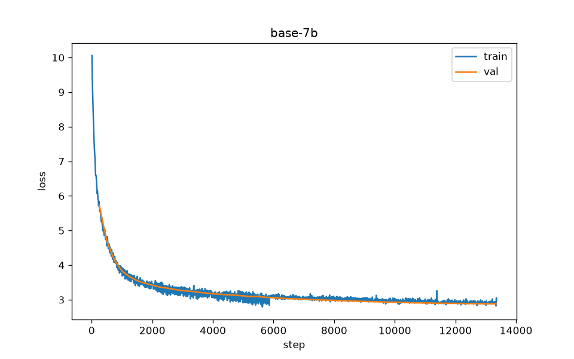

<p align="center">
  
</p>

**μllm** (micro-LLM, or `ullm`) is a small, modern, fully featured large language model built from scratch. It has a pre-trained **base model** and a fine-tuned **assistant model** for chat.

The goal is to demystify LLMs by building every core part by hand: the transformer, the training loop, and inference. See [intro.md](intro.md) for the motivation.

## At a glance

| | |
|---|---|
| Model | Decoder-only GPT, ~350M params, 24 layers, d_model 1024, 16 heads |
| Block | RoPE, RMSNorm (pre-norm), SwiGLU, no biases, tied embeddings |
| Context | 1024 tokens |
| Tokenizer | GPT-2 (`tiktoken`) + 3 chat tokens: `<\|user\|>`, `<\|assistant\|>`, `<\|end\|>` |
| Pre-training | 7B FineWeb-Edu tokens on 4×H100, 3.3 h, $23 |
| Base model | [mattiasz/ullm-base](https://huggingface.co/mattiasz/ullm-base) |
| Pre-train data | [mattiasz/ullm-fineweb-edu-shards](https://huggingface.co/datasets/mattiasz/ullm-fineweb-edu-shards): 71 tokenized shards (shard 0 = validation) |
| Fine-tuning | SFT on smol-smoltalk, 1×H100 |
| Target | Beat GPT-2 small (124M) on HellaSwag and WikiText-103 |
| Inference | CLI on CUDA, Apple Silicon (MPS), or CPU |

We write the model, training (pre-train and SFT), data pipeline glue, inference, and CLI. Libraries handle tensors and autograd (PyTorch), tokenization (`tiktoken`), dataset download and upload (`huggingface_hub`, `pyarrow`), and benchmarks (`lm-evaluation-harness`). No pretrained weights are used for our model.

## Pre-training

Training loss over 13,351 steps (7B tokens). Final val loss 2.881. Details: [results/base-7b](results/base-7b/results.md).

<p align="center">
  
</p>

## Setup

Requires Python 3.12 and [uv](https://docs.astral.sh/uv/).

```sh
git clone https://github.com/mAzurkovic/ullm.git
cd ullm
uv sync
uv run pytest
```

## Usage

Planned: one command per stage.

```sh
uv run ullm prepare                                  # tokenize FineWeb-Edu into shards
uv run torchrun --nproc_per_node=8 -m ullm pretrain  # pre-train the base model (see below)
uv run ullm sft                                      # fine-tune the assistant
uv run ullm eval                                     # benchmarks and human-judged tests
uv run ullm complete "The meaning of life is"        # base model completion
uv run ullm chat                                     # chat with the assistant
```

## Train on a GPU node

Any Linux machine with NVIDIA GPUs, CUDA drivers, and SSH works. These steps use a [Vast.ai](https://vast.ai) on-demand instance.

**1. Rent the instance.** Pick **On-demand** (not Interruptible), **H100 SXM** if the price is close to PCIe, **~80 GB disk**, and set the **CUDA version filter to 13.0 or newer**: the locked PyTorch build needs it. An Ubuntu image with CUDA drivers is enough: `uv` installs Python and PyTorch. Note the hourly price and the SSH command on the instance card.

**2. Connect and set up.**

```sh
ssh -p <port> root@<host>
nvidia-smi                                   # GPUs, memory; "CUDA Version" must be 13.0 or newer
apt-get update && apt-get install -y git curl tmux build-essential
curl -LsSf https://astral.sh/uv/install.sh | sh && source $HOME/.local/bin/env
git clone https://github.com/mAzurkovic/ullm.git && cd ullm && pwd   # note this path for step 6 (Vast.ai: /workspace/ullm)
uv sync
```

**3. Start training inside `tmux`**, so it keeps running if SSH drops. (Vast.ai may already open a `tmux` session for you; then skip `tmux new`.)

```sh
tmux new -s train
uv run torchrun --standalone --nproc_per_node=<gpus> -m ullm pretrain \
  --run <name> --device cuda --compile --hourly-rate <USD per hour> \
  --shards-repo mattiasz/ullm-fineweb-edu-shards
```

The shards (14 GB) download from the Hub first; a restart completes a broken download. On **H100 PCIe**, add `--gpu-peak-tflops 756` so MFU is right.

For a **short test run** (about 380 steps, a checkpoint every 100 steps, stop at $25), add:

```sh
  --max-tokens 2e8 --checkpoint-every 100 --budget 25
```

Leave `tmux` with `Ctrl-b d`; come back with `tmux attach -t train`.

**4. Watch it.** Every log line shows loss, tokens/s, MFU, ETA, and the cost since this start. At step 200 the run stops by itself if the projected cost is over `--budget` (default $75) and prints the `--max-tokens` that fits.

```sh
tail -f results/<name>/metrics.csv           # all logged numbers
cat results/<name>/samples.txt               # sample text every 500 steps
watch -n 5 nvidia-smi                        # GPU load and memory
```

**5. Resume after a crash.** Run the same command again with `--resume`. It continues from the latest checkpoint (every 1000 steps by default). The shards are already local, so you can drop `--shards-repo` if the Hub is unreachable.

**6. Copy results back, check them, then destroy the instance.** On your Mac:

```sh
mkdir -p results checkpoints/<name>
scp -P <port> -r root@<host>:<repo path>/results/<name> results/
scp -P <port> -r root@<host>:<repo path>/checkpoints/<name>/final checkpoints/<name>/
ls -la results/<name> checkpoints/<name>/final   # metrics.csv, loss.png, model.safetensors
```

Only when the files are there, **destroy** the instance in the Vast.ai console. A stopped instance still bills for its disk.

## Project layout

```
ullm/
  config.py      # model and training config dataclasses
  model.py       # GPT: RoPE, RMSNorm, SwiGLU, attention, block
  tokenizer.py   # GPT-2 tokenizer + chat tokens, render_chat()
  data.py        # data preparation and loaders
  train.py       # shared loop for pre-training and SFT
  generate.py    # sampling loop
  eval.py        # benchmarks and generation tests
  cli.py         # ullm complete | chat | prepare | pretrain | sft | eval
tests/
assets/          # logo and banner
```

## Docs

- [intro.md](intro.md): background and motivation
- [design.md](specs/design.md): requirements and technical design
- [milestones.md](specs/milestones.md): build plan

## References

- Vaswani et al., [Attention Is All You Need](https://arxiv.org/abs/1706.03762) (2017)
- Sebastian Raschka, *Build a Large Language Model (From Scratch)* (2024)
- [FineWeb-Edu](https://huggingface.co/datasets/HuggingFaceFW/fineweb-edu) and [smol-smoltalk](https://huggingface.co/datasets/HuggingFaceTB/smol-smoltalk)
