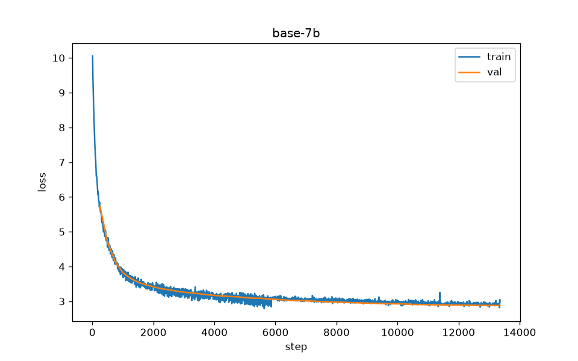

# base-7b

The real pre-training run: 7B tokens of FineWeb-Edu. The weights are on the Hub at [mattiasz/ullm-base](https://huggingface.co/mattiasz/ullm-base).

## Setup

| | |
|---|---|
| Provider | Vast.ai, on-demand, instance 61831956 (no 8× H100 node was available) |
| GPU | 4 × NVIDIA H100 80GB HBM3 (SXM, 700 W), driver 610.57, CUDA 13.3 |
| Price | $6.956 per hour for the node ($1.74 per GPU-hour) |
| Model | 359,842,816 params (24 layers, d_model 1024, 16 heads), context 1024 |
| Data | `mattiasz/ullm-fineweb-edu-shards`: 70 train shards, shard 0 for validation |
| Training | 13,351 steps of 512 × 1024 tokens, micro-batch 16, 8 accumulation steps per GPU, `--compile`, bf16 autocast |
| Schedule | AdamW, peak LR 3e-4, 700 warmup steps, cosine decay to 3e-5 |

## Results

| | |
|---|---|
| Final val loss | **2.881** |
| Final train loss | 2.96 (one batch; the train loss varies by about ±0.05 between batches) |
| Training time | 11,984 s (3.33 h) |
| Cost | $23.15 of training time; the node also billed for setup and the shard download |
| Throughput | 595,400 tokens/s mean (steps 100 to 13,351) |
| MFU | 32.6% median (of 4 × 989 TFLOPs bf16) |
| Stability | grad norm about 0.2 for most of the run; one spike to 2.24 at step 10,630, with no effect on the loss; no restarts |

| Step | Val loss |
|---|---|
| 250 | 5.732 |
| 500 | 4.699 |
| 1,000 | 3.828 |
| 2,000 | 3.422 |
| 4,000 | 3.172 |
| 7,000 | 3.016 |
| 10,000 | 2.930 |
| 13,351 | 2.881 |

Most of the drop happened in the first 2,000 steps. The last 6,000 steps gave about 0.09.

Against the projection in `results/h100-test/`: 156,200 × 4 × 0.95 ≈ 594K tokens/s projected, 595K measured. Scaling from 1 to 4 GPUs was about 95%.

## Samples

Final samples at step 13,351: temperature 0.8, top-k 50, seed 0, 64 tokens (`samples.txt`).

> **The capital of France is** a huge city in the south of France.
> \- France is the second most populous country in Europe and the second largest country in Europe.
> \- It is the most populous country in Europe and the second most populous country in Europe. [...]

> **Photosynthesis is the process by which** a plant converts sunlight into chemical energy. Photosynthesis is a major energy source for organisms throughout the world. All plants require carbon dioxide and oxygen to survive. [...]

> **In 1969, astronauts** Neil Armstrong and Edwin 'Buzz' Aldrin, along with other astronauts, became the first people to walk on the surface of the moon. [...]

`ullm complete "zebras live in"` with the weights downloaded from the Hub, default settings:

> **zebras live in** their own territories. The males are known for their loud, piercing cries and high-pitched sounds. In the case of the jaguar, the most vocal males will growl [...]

Spanish few-shot (`sí = yes`, `no = no`, `perro = dog`, `gato =`), temperature 0.3:

> gait
> há = he
> há = he [...]

## Findings

- The text is fluent English. It stays on topic for a sentence or two, then drifts (zebras to jaguars).
- It keeps the style of the prompt: lists, explanations, stories.
- It gets some facts right (Apollo 11, photosynthesis) and states wrong facts with confidence (Paris "in the south of France").
- It repeats phrases, more so at low temperature.
- It has almost no Spanish: it copies the `word = word` format but guesses from spelling ("gato" → "gait").
- These are expected for a 360M base model trained on 7B English tokens. Supervised fine-tuning teaches it to answer instead of continue. More facts need a bigger model or more tokens.
