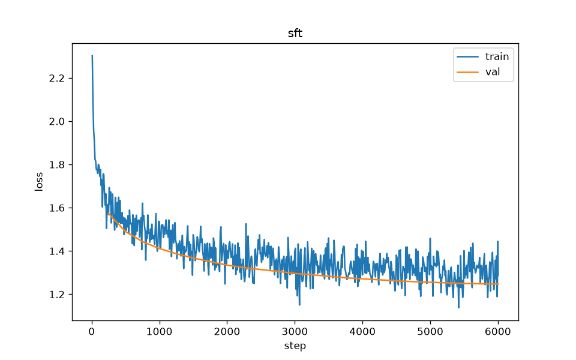

# sft

Supervised fine-tuning of [mattiasz/ullm-base](https://huggingface.co/mattiasz/ullm-base) on smol-smoltalk conversations, 1 epoch, loss on the assistant tokens only.

## Setup

| | |
|---|---|
| Provider | Vast.ai, on-demand, instance 61943164 |
| GPU | 1 × NVIDIA H100 NVL (PCIe class, 400 W), MFU against 835 TFLOPs bf16 |
| Price | $3.215 per hour |
| Model | 359,842,816 params, started from `mattiasz/ullm-base` |
| Data | `HuggingFaceTB/smol-smoltalk`: 384,253 train rows, 20,233 val rows (the dataset's test split) |
| Rows | 1025 tokens, padded; 206.5M assistant tokens in train (about 540 per row) |
| Training | 6,003 steps of 64 conversations, micro-batch 16, 4 accumulation steps, `--compile`, bf16 autocast |
| Schedule | AdamW, peak LR 3e-5, 100 warmup steps, linear decay to 0 |

Prep: 76,088 train conversations skipped (system message, or a first exchange longer than 1024 tokens); 175,317 cut after the last exchange that fits.

## Results

| | |
|---|---|
| Final val loss | **1.248** (assistant tokens only) |
| Final train loss | 1.29 (one batch; the train loss varies by about ±0.1 between batches) |
| Training time | 3,417 s (57 min) |
| Cost | $3.05 of training time |
| Throughput | 121,800 tokens/s mean (steps 100 to 6,003, padding included) |
| MFU | 31.5% median |
| Stability | grad norm 0.62 to 0.81 after warmup; no spikes, no restarts |

| Step | Val loss |
|---|---|
| 250 | 1.574 |
| 500 | 1.490 |
| 1,000 | 1.412 |
| 2,000 | 1.335 |
| 3,000 | 1.296 |
| 4,000 | 1.271 |
| 5,000 | 1.255 |
| 6,003 | 1.248 |

The val loss fell through the whole run, slower after step 2,000. The base model scores 2.88 on web text; this is a different loss (assistant replies only), so the two do not compare.

## Samples

Final samples at step 6,003: temperature 0.8, top-k 50, seed 0, 64 tokens (`samples.txt`).

> **What is the capital of France?** The capital of France is Paris.`<|end|>`

> **Explain photosynthesis in one sentence.** Photosynthesis is the process by which plants produce their own food using sunlight, water, and certain carbon dioxide.`<|end|>`

> **Who were the first people to walk on the Moon?** The first people to walk on the Moon were the Native American tribes that lived in the eastern part of the United States, [...]

The poem and the coding tips reach the 64-token cap before `<|end|>`.

`ullm chat --model checkpoints/sft/final`, default settings (temperature 0.8, 256 tokens):

> **> what is the biggest planet in our solar system**
> The Earth, Moon, and Mars have all been discovered by civilizations since the dawn of humanity. These planets, known as the Kuiper Belt, [...]
>
> **> the largest planet in our solar system?**
> Considering that the largest planet in our solar system is the Moon, [...]
>
> **> the moon isnt a planet - what is the largest planet?**
> The Moon is not a planet, but rather a small, rocky moon. [...]

## Findings

- It answers as an assistant instead of continuing the text, and short answers stop on `<|end|>`.
- It uses the earlier turns: on turn 3 it accepts the correction "the Moon is not a planet".
- It never writes a `<|user|>` turn.
- It states wrong facts with confidence (Moon walkers, the largest planet). SFT teaches the format, not facts; the base model has the same gaps.
- Long answers drift and run to the token cap, more so when the first sentence goes wrong.
- These are expected for a 360M model trained on 7B tokens.
