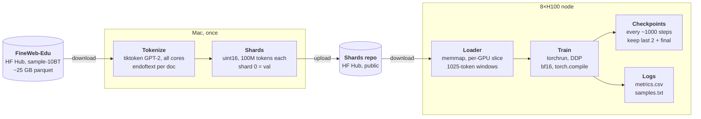
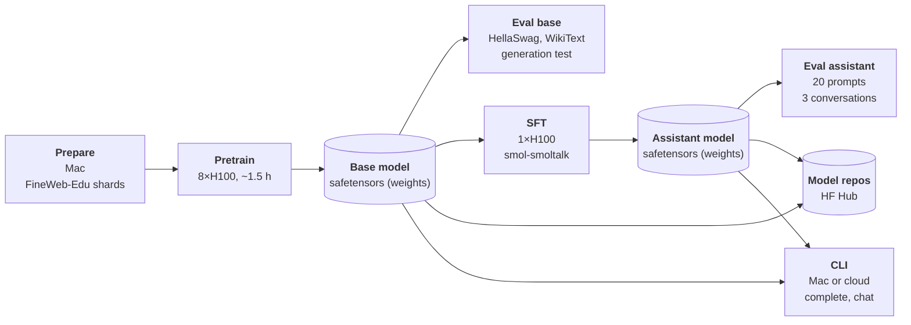

# ullm: Requirements and Design

## Requirements

- R1. Budget: pre-training costs at most $75 USD and at most 24 h wall-clock. SFT and eval not budgeted (cheap). Soft cap ~$25 for test runs.
- R2a. Base model:
  - Beats OpenAI GPT-2 small (124M) on HellaSwag (0-shot, acc_norm) and WikiText-103 perplexity, both measured by us with the same harness.
  - Generation test: 10 fixed prompts, 256 tokens, best of 3 samples. Grammatical throughout, on topic for at least ~150 tokens, no repetition loops. Human judged.
- R2b. Assistant:
  - Follows chat format, ends its turn with `<|end|>`, never writes the user turn.
  - Relevant, coherent answers on 20 fixed prompts (factual, creative, how-to). Handles 3 fixed 2 to 3 turn conversations. Human judged.
  - Wrong facts acceptable. SFT only. No math, code, safety tuning, RLHF/DPO.
- R3. English only, general web text.
- R4. Training on rented cloud GPUs. Inference portable: same code on M2 Pro (MPS), CUDA, or CPU, from one self-contained checkpoint. CLI only (`complete`, `chat`). No web UI.
- R5. Public Git repo (user creates). Minimal code comments: code is the source of truth. Reproducible: one command per stage, fixed seeds, pinned deps. Small results (<10 MB per run) in Git. Weights published to HF Hub. Datasets regenerated by script. Write-up done later by user.
- R6. Any GPU provider, cheapest reliable. Provider-neutral code: plain Linux + NVIDIA + CUDA + SSH.

## Overview

- Decoder-only GPT, ~350M params, modern block (RoPE, RMSNorm, SwiGLU), 1024 context.
- Pre-trained on ~7B FineWeb-Edu tokens on one 8×H100 node (~1.5 h), then SFT on smol-smoltalk on 1×H100.

## Scope

- We write: transformer model, training loop (pre-train + SFT), SFT chat formatting and loss mask, data pipeline glue, inference loop, CLI, lm-eval adapter.
- Libraries:
  - PyTorch: tensors, autograd, AdamW, `torch.compile`, bf16 autocast, DDP, `scaled_dot_product_attention`.
  - `tiktoken`: GPT-2 encoding, extended with 3 chat special tokens.
  - `huggingface_hub` + `pyarrow`: download and read FineWeb-Edu and smol-smoltalk parquet files, upload shards and weights.
  - `lm-evaluation-harness` (EleutherAI): HellaSwag, WikiText.
  - HF `transformers`: only to load GPT-2 small as the eval baseline.
- Not used: pretrained weights for our model, Lightning, HF Trainer.

## Model

| Param | Value |
|---|---|
| Params | ~350M (embeddings tied) |
| Layers | 24 |
| d_model | 1024 |
| Heads | 16 (head dim 64), MHA |
| MLP | SwiGLU, hidden 2816 |
| Norm | RMSNorm, pre-norm, final norm before head |
| Position | RoPE |
| Biases | none |
| Context | 1024 (pre-train, SFT, inference) |
| Vocab | GPT-2 50,257 + 3 special tokens, padded to 50,304 |

## Data Model

- Pre-train shards: flat `uint16` token arrays, 100M tokens per file. Shard 0 = validation. ~14 GB for 7B tokens. Cached in a public HF Hub dataset repo. Dataset card credits FineWeb-Edu (ODC-By, derived from Common Crawl).
- Special tokens: `<|user|>` 50257, `<|assistant|>` 50258, `<|end|>` 50259. Documents separated by `<|endoftext|>` 50256.
- Chat template: `<|user|>{text}<|end|><|assistant|>{text}<|end|>...`. No system prompt.
- SFT example: token IDs + loss mask (1 on assistant tokens and their `<|end|>`, else 0). Truncated at a turn boundary to 1024. Dropped if first exchange exceeds 1024.
- Checkpoint: `model.safetensors` + `config.json` (portable, HF Hub). `optimizer.pt` separate, resume only.
- Run results: `results/<run>/` with `config.json`, `metrics.csv`, `loss.png`, `samples.txt`, `results.md`. Committed to Git.

## Pre-training Pipeline



Steps 1 to 4 run once on the Mac (~16 GB free disk). Step 5 runs on the 8×H100 node.
1. `ullm prepare` downloads `sample-10BT` parquet files one at a time with `huggingface_hub`, reads the text with `pyarrow`, and deletes each file after use. It stops downloading once the shards are full.
2. Tokenize in parallel with GPT-2 `tiktoken`, append `<|endoftext|>` after each document.
3. Write `uint16` shards of 100M tokens. Shard 0 held out for validation.
4. Push shards to a public HF Hub dataset repo, then delete raw data and local shards.
5. On the GPU node, download shards, then `torchrun --nproc_per_node=8 -m ullm pretrain` streams 1025-token windows (1024 inputs + 1 shifted target) per GPU via memmap. Documents packed back to back, attention crosses boundaries.

## Training Recipe

| Setting | Pre-train | SFT |
|---|---|---|
| Hardware | 8×H100 80 GB SXM | 1×H100 |
| Data | FineWeb-Edu, `--max-tokens 7e9` (fixed) | smol-smoltalk, 1 epoch, 1% held out |
| Optimizer | AdamW β=(0.9, 0.95), wd 0.1 on matrices only | same |
| Peak LR | 3e-4 | 3e-5 |
| Schedule | linear warmup 700 steps, cosine to 10% | short warmup, linear to 0 |
| Batch | ~0.5M tokens (512 × 1024), grad accum auto | ~64 conversations, padded to 1024 |
| Steps | ~14k | 1 epoch |
| Precision | bf16 autocast, fp32 master weights | same |
| Grad clip | 1.0 | 1.0 |
| Loss | all tokens | masked, assistant tokens only |
| Est. time / cost | ~1.5 h (1.3 to 1.8), ~$35 to 50 | ~20 to 40 min, ~$1 to 3 |

Logging, same loop for both stages, rank 0 only:
- Every 10 steps: `step | loss | lr | grad_norm | tok/s | MFU | elapsed | ETA | est. cost` to console and `metrics.csv`. Cost = elapsed h × hourly rate from config.
- Every 250 steps: validation loss.
- Every 500 steps: 5 fixed prompts, 64 tokens, fixed seed, to console and `samples.txt`.
- Budget check: if ETA at step 200 projects past budget, stop, lower `--max-tokens`, restart.

## Inference

- Simple loop, no KV cache:
  1. Encode prompt (`complete`) or `render_chat(conversation) + <|assistant|>` (`chat`).
  2. `logits = model(tokens[-1024:])`, take last position.
  3. Temperature, then top-k, then sample. Temperature 0 = greedy.
  4. Append token, stream decoded text.
  5. Stop on `<|end|>` (chat), `<|endoftext|>` (complete), or `max_new_tokens`.
- `chat` keeps full history, drops oldest full turns when over 1024.
- Defaults: temperature 0.8, top-k 50, max_new_tokens 256, seed random (fixed for evals and training samples), device auto (cuda, mps, cpu).
- `render_chat()` is shared by SFT prep and CLI, so format cannot drift.

## Evaluation

| Check | Tool | Pass condition | Req |
|---|---|---|---|
| HellaSwag 0-shot acc_norm | lm-evaluation-harness | ours > GPT-2 small | R2a |
| WikiText-103 perplexity | lm-evaluation-harness `wikitext` | ours < GPT-2 small | R2a |
| Generation test: 10 prompts, 256 tokens, best of 3 | `ullm eval` | human: grammatical, on topic ≥150 tokens, no loops | R2a |
| Assistant test: 20 prompts + 3 multi-turn convos | `ullm eval` | human: relevant, coherent, stops turn | R2b |
| FineWeb-Edu val loss | training loop | none, training signal | n/a |

- Base model evaluated at 1024 context.
- All prompt sets fixed in `ullm/prompts.py`, frozen before the real run.
- Output: `results/<run>/results.md` with scores beside GPT-2 small and all samples.

## Components

```
ullm/
  README.md        # what, setup with uv, one command per stage
  pyproject.toml, uv.lock
  ullm/
    config.py      # ModelConfig, PretrainConfig, SFTConfig dataclasses, CLI overrides
    model.py       # GPT: RoPE, RMSNorm, SwiGLU, attention, block
    tokenizer.py   # tiktoken GPT-2 + 3 special tokens, render_chat()
    data.py        # prepare_pretrain(), prepare_sft(), batch loaders
    train.py       # shared loop: pretrain + SFT
    generate.py    # simple sampling loop
    eval.py        # lm-eval adapter, generation and assistant tests
    prompts.py     # fixed prompt sets
    cli.py         # ullm complete | chat | prepare | pretrain | sft | eval
  tests/           # pytest: model shapes, render_chat mask, tiny CPU overfit
  results/<run>/
  intro.md
  specs/           # design.md, milestones.md, per-feature tasks
```

- Python 3.12, `uv` with `uv.lock`.
- Config: dataclasses with defaults, overridden by CLI flags. No YAML.
- Multi-GPU: `torchrun --nproc_per_node=N`. Same script runs 1 GPU for test runs.

## End-to-end Flow



## Key Decisions

- D1. Write the LLM, use libraries for tokenizer, eval, data download. Alternative: write everything. Why: understanding lives in model, training, inference. We can expand with custome tokenizer later.
- D2. FineWeb-Edu `sample-10BT`. Alternative: plain FineWeb, raw Common Crawl. Why: higher quality per token under fixed budget, suits Q&A.
- D3. One 8×H100 node, ~1.5 h. Alternative: 1×H100 for 24 h. Why: same compute per dollar, a crash costs minutes not a day.
- D4. ~350M params on ~7B tokens (Chinchilla 20:1, compute ≈ 6ND). Alternative: 124M (barely beats bar), 770M (~$150). Why: compute-optimal for budget with ~1/3 margin.
- D5. 1024 context everywhere. Alternative: 2048, or extend for SFT. Why: exact GPT-2 comparison, simplest, enough for 2 to 3 turns.
- D6. Modern block (RoPE, RMSNorm, SwiGLU, no biases, tied embeddings). Alternative: GPT-2 original. Why: better quality per parameter at same compute, small code.
- D7. AdamW + cosine, GPT-3 350M hyperparams. Alternative: Muon, WSD. Why: proven at our size, low risk for one-shot run.
- D8. Data prep once on the Mac, shards cached on HF Hub. Alternative: prep on a rented 1×H100 or the 8×H100 node. Why: free, easy to debug without paying for a GPU per hour, 300 Mbps upload pushes 14 GB in ~6 min. GPU nodes only download shards.
- D9. smol-smoltalk. Alternative: UltraChat 200k, Alpaca. Why: built for small models, multi-turn, Apache-2.0.
- D10. 3 special tokens, assistant-only loss mask, stop on `<|end|>`. Why: minimal standard chat format.
- D11. SFT at 1024. Alternative: 2048 via RoPE. Why: simplicity.
- D12. Full fine-tune, LR 3e-5, 1 epoch. Alternative: LoRA. Why: model fits easily, simpler.
- D13. Inference without KV cache, temperature + top-k. Why: simplest, fast enough at 350M and 1024 tokens.
- D14. Eval trimmed to HellaSwag + WikiText + 2 human tests. WikiText replaces FineWeb-Edu val loss for comparison. Why: FineWeb-Edu val is in-distribution for us only, unfair to GPT-2.
- D15. Fixed `--max-tokens 7e9` with ETA check. Alternative: auto-size from measured throughput. Why: schedule known from step 0, no runtime magic.

## Future Improvements

- KV cache, top-p sampling.
- 2048 context extension via RoPE.
- Extra benchmarks: ARC-Easy, PIQA, LAMBADA (one word in harness command).
- Muon optimizer, WSD schedule.
- DPO / preference tuning.
- Local web chat UI.

## Open Questions

- OQ1. GPU provider. 1×H100 test run: Vast.ai on-demand (Lambda 1× needs a 1-week reservation; Lambda 8× out of capacity 2026-11-21). 8×H100 real run: compare Lambda, RunPod, Vast.ai right before the run. Owner: user.
- OQ5. HF Hub repo names. Shards: `mattiasz/ullm-fineweb-edu-shards`. Base model: `mattiasz/ullm-base`. Assistant: decide at M5.
